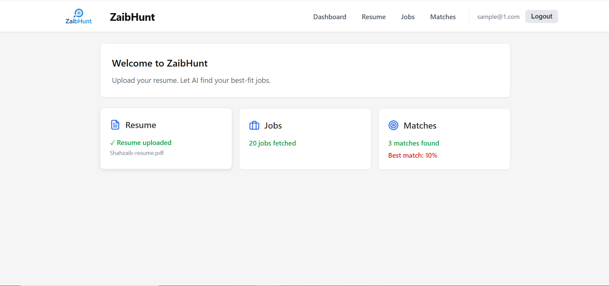
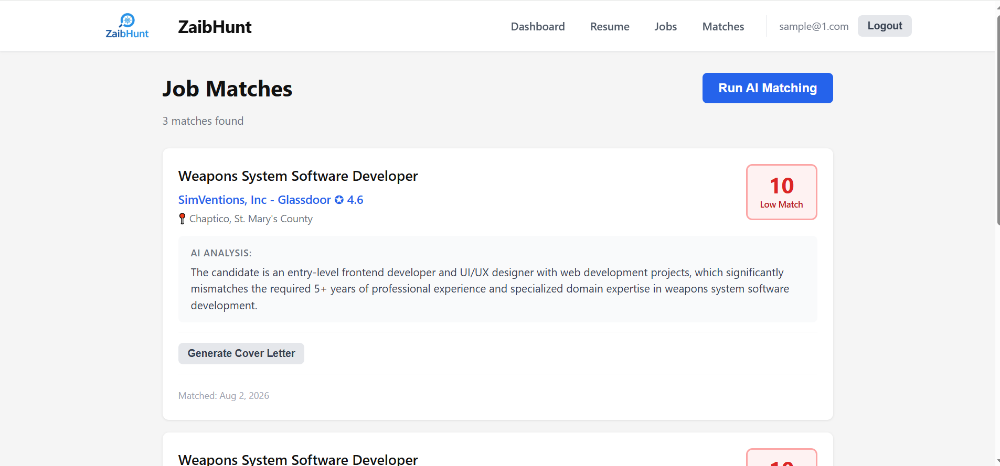
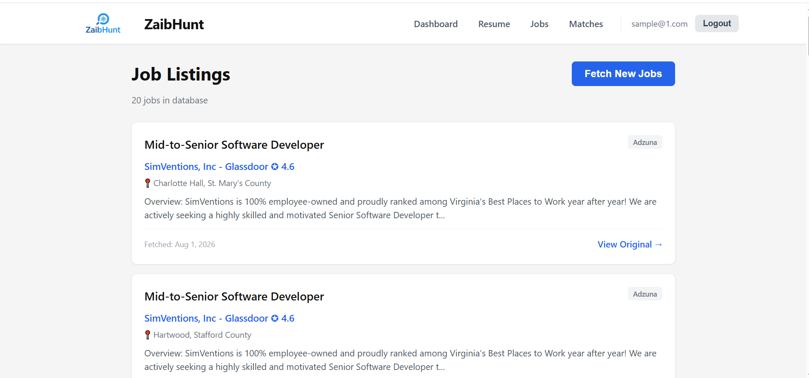
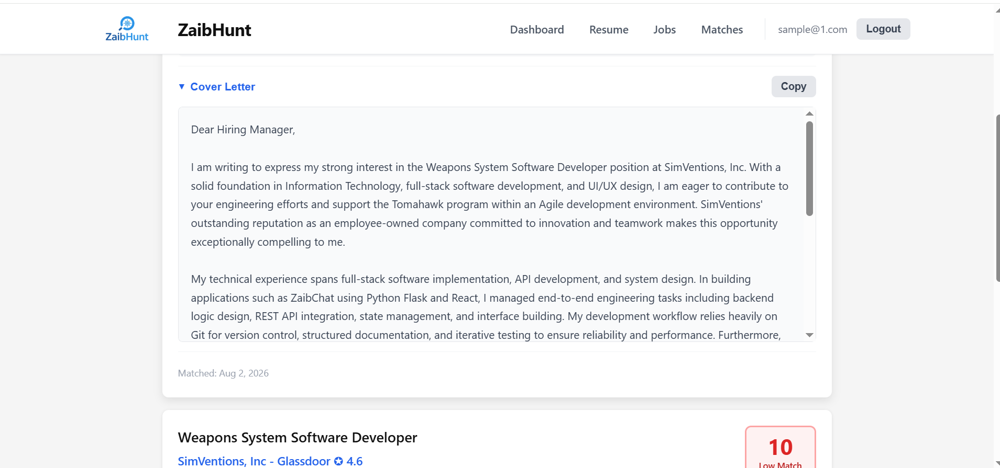

# ZaibHunt

**AI-powered job hunting agent — upload your resume, get AI-matched jobs, and generate tailored cover letters, all in one place.**

🔗 **Live Demo:** [zaibhunt.netlify.app](https://zaibhunt.netlify.app)
🔧 **Backend API:** [shzahzaib321.pythonanywhere.com](https://shzahzaib321.pythonanywhere.com/api/health)



---

## What it does

ZaibHunt is a full-stack web app that automates the tedious parts of job hunting:

1. **Upload your resume** (PDF) — text is extracted and stored automatically
2. **Fetch live job listings** from a real job board API
3. **Run AI matching** — Gemini analyzes your resume against every job and returns a fit score (0–100) with a written explanation
4. **Generate tailored cover letters** — one click, AI-written, specific to each job

Built as a portfolio project to demonstrate full-stack development: authentication, file handling, third-party API integration, and AI integration, all wired together into one working product.

---

## Screenshots

| Dashboard | Job Matches |
|---|---|
|  |  |

| Job Listings | Cover Letter |
|---|---|
|  |  |

*(Screenshots taken from the live deployment above.)*

---

## Tech Stack

**Frontend**
- React (Vite)
- React Router
- Axios
- Deployed on Netlify

**Backend**
- Python Flask (application factory pattern)
- SQLAlchemy ORM + SQLite
- Flask-JWT-Extended (authentication)
- pdfplumber (PDF text extraction)
- Deployed on PythonAnywhere

**AI / Third-party APIs**
- Google Gemini API (`google-genai` SDK) — resume/job matching + cover letter generation
- Adzuna API — live job listings

---

## Features

- 🔐 **JWT authentication** — signup, login, protected routes, persistent sessions
- 📄 **Resume upload** — PDF parsing with pdfplumber, stored per user
- 💼 **Job fetching** — pulls live listings from Adzuna, with duplicate detection
- 🎯 **AI fit scoring** — Gemini compares resume to job description, returns a 0–100 score and a written explanation
- ✉️ **AI cover letters** — generated per match, one click, copy-to-clipboard
- 🎨 **Custom branding** — logo, favicon, consistent UI across every page

---

## Security: prompt injection discovery and fix

While testing cover letter generation, a job description scraped from a live job board contained **hidden text instructing the AI to insert a specific keyword and code into its output** — a real-world prompt injection attempt embedded in third-party data.

**The problem:** the original prompt sent the job description straight to Gemini without distinguishing "data to analyze" from "instructions to follow." Gemini obeyed the embedded instruction, and the injected content showed up in the generated cover letter.

**The fix:** the prompt was rewritten to explicitly wrap the job description in clear delimiters and instruct the model to treat it strictly as data — ignoring any embedded commands, codes, or formatting instructions within it. Verified with a before/after test: re-running the exact same poisoned job listing produced a clean, correct cover letter with no injected content.

This is a small-scale example of a real class of LLM security issue — any app that feeds untrusted, scraped, or user-submitted text into an AI prompt is exposed to this unless the prompt is explicitly hardened against it.

---

## Architecture

```
ZaibHunt/
├── backend/               Flask API (PythonAnywhere)
│   ├── app/
│   │   ├── models.py       User, Resume, Job, Match models
│   │   ├── routes/         auth, resume, jobs, matches, health
│   │   └── services/
│   │       └── gemini.py   Gemini prompt construction + calls
│   ├── config.py
│   └── requirements.txt
│
├── frontend/               React + Vite (Netlify)
│   └── src/
│       ├── api/             axios client + per-resource API calls
│       ├── context/         AuthContext (JWT session state)
│       ├── components/      Header, ProtectedRoute
│       └── pages/            Login, Signup, Dashboard, Resume, Jobs, Matches
│
└── README.md
```

Frontend and backend are deployed independently (Netlify + PythonAnywhere) and communicate purely over HTTP — a standard, decoupled full-stack architecture.

---

## Running locally

**Backend**
```bash
cd backend
python -m venv venv
venv\Scripts\activate       # Windows
pip install -r requirements.txt
# create a .env file with GEMINI_API_KEY, JWT_SECRET_KEY, ADZUNA_APP_ID, ADZUNA_APP_KEY
python app.py
```

**Frontend**
```bash
cd frontend
npm install
npm run dev
```

---

## What I'd improve next

- Move from SQLite to PostgreSQL for a production-grade database
- Add loading progress feedback for AI matching (currently a single spinner while processing every job)
- Expand test coverage with automated tests rather than manual curl/browser testing
- Add pagination to the Jobs page for larger result sets

---

Built by [Shahzaib Waheed](https://github.com/shahzaibuxui-sketch) — Frontend Developer & UI/UX Designer.
